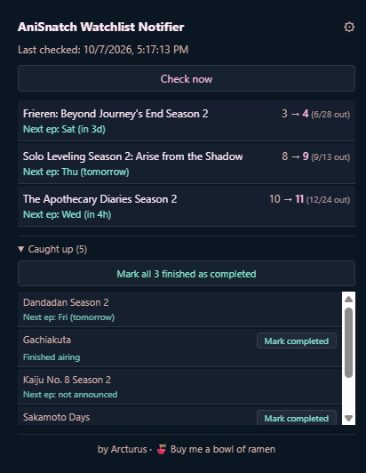
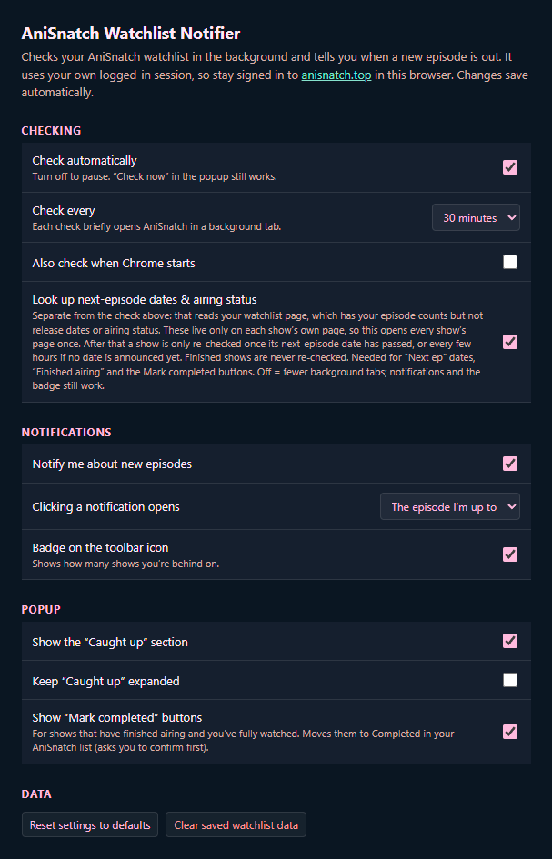

# AniSnatch Watchlist Notifier

*Made by **Arcturus***

A small Chrome extension that keeps an eye on your [AniSnatch](https://anisnatch.top) watchlist and tells you when a new episode of something you're watching is out.

  
  &nbsp;
  

## What it does

- **New-episode notifications.** It checks your watchlist in the background (every 30 minutes by default) and pops up a notification when an episode comes out.
- **Toolbar badge.** The number on the icon is how many shows you're behind on.
- **Popup list.** Click the icon to see:
  - what you're behind on, with a link straight to the next episode
  - when the next episode is due
  - a "Caught up" section for everything else
- **Mark completed.** Shows that have finished airing and that you've fully watched get a "Mark completed" button. There's also a "Mark all" button. They move the show to *Completed* in your AniSnatch list, and each one asks you to confirm first.
- **Settings.** Click ⚙ in the popup to change how often it checks, turn notifications or the badge off, and more.

## Install

The extension isn't on the Chrome Web Store, so you add it by hand. It takes about a minute.

1. **Download and unzip** the extension: grab the `.zip` from the [latest release](https://github.com/arc2rus-e/anisnatch-watchlist-notifier/releases/latest) (the official download). Put the unzipped folder somewhere permanent, such as your Documents folder. Chrome loads the extension from this folder every time it starts, so don't delete it or leave it in Downloads if you clear that out.
2. **Open the extensions page:** type `chrome://extensions` in the address bar and press Enter.
3. **Turn on Developer mode** with the switch in the **top-right corner**.
4. **Click "Load unpacked"**, the button that appears at the top-left.
5. **Select the extension folder.** Pick the folder that has `manifest.json` directly inside it, not a folder above it. If Chrome says the manifest is missing, you've picked the wrong level.
6. **Pin it:** click the puzzle-piece icon 🧩 in the toolbar, then the pin next to *AniSnatch Watchlist Notifier*, so the icon stays visible.
7. **Sign in to [anisnatch.top](https://anisnatch.top)** in the same Chrome, if you aren't already. The extension reads your watchlist through your own login.
8. **Click the icon, then "Check now"** to fill it in for the first time.

The same steps work in **Edge** (`edge://extensions`, with Developer mode in the left sidebar) and **Brave** (`brave://extensions`).

> Chrome may sometimes show a notice about extensions in developer mode. It's expected for extensions installed this way. Close it and keep the extension enabled.

### Updating to a new version

Replace the files in your extension folder with the new ones. Then open `chrome://extensions` and click the ↻ reload icon on the extension's card. Your settings and saved data are kept.

### Uninstalling

On `chrome://extensions`, click **Remove** on the extension's card. You can then delete the folder.

## Good to know

- **Background tabs.** To read your watchlist, the extension briefly opens AniSnatch in a background tab and closes it again. The first check after installing also opens each show's page once to fetch next-episode dates, so you'll see a short burst of tabs. After that it's usually none or a few. If you'd rather avoid this, turn off *Look up next-episode dates* in Settings.
- **Privacy.** Everything stays in your browser. The extension only talks to anisnatch.top, using your existing login, and sends your data nowhere else. Its permissions are alarms (scheduled checks), storage (remembering your list), notifications, and access to anisnatch.top.
- **Not logged in?** If the popup says *Not logged in to AniSnatch*, sign in on anisnatch.top in the same Chrome and press **Check now**.
- **No notifications?** On Windows, check Settings → System → Notifications and make sure Google Chrome is allowed and Do Not Disturb or Focus is off. On macOS, check System Settings → Notifications → Google Chrome.
- **Icon doesn't respond to the first click?** Chrome sometimes needs a moment to wake an idle extension. Click again.

## Support

This is a free side project. If it saves you from missing episodes, you can [buy me a bowl of ramen on Ko-fi](https://ko-fi.com/elyss0n) 🍜. It helps me keep it maintained.

## License

Copyright © 2026 Arcturus. Released under the [GNU GPL v3](LICENSE): you're free to use, study and modify it, but if you share a modified version you must publish its source under the same licence and keep this copyright notice.

---

*Unofficial fan-made tool. Not affiliated with or endorsed by AniSnatch.*
